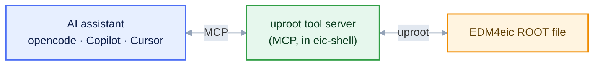
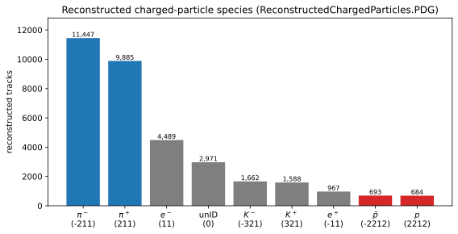

<style>
/* Mermaid: force diagram label text dark so it stays readable on the
   light node fills in BOTH light and dark mode. The Carpentries dark
   theme sets `p`/`li` color and darkens `pre` backgrounds, which would
   otherwise turn mermaid's label text light (invisible on light nodes)
   and the diagram surface dark. We override both, with !important to
   beat the theme rules and mermaid's own inline styles. */
.mermaid { background: transparent !important; }
/* Hide the Workbench "Diagram source code" spoiler under each diagram */
.mermaid-img-wrapper details { display: none !important; }
.mermaid .nodeLabel, .mermaid .edgeLabel, .mermaid .label,
.mermaid .cluster-label, .mermaid text, .mermaid tspan,
.mermaid span, .mermaid p, .mermaid foreignObject div {
  color: #10204a !important;
  fill: #10204a !important;
}
.mermaid .edgeLabel, .mermaid .edgeLabel p, .mermaid .edgeLabel rect {
  background-color: #e2e8f0 !important;
}
/* AI prompts: paste-into-your-assistant blocks. Styled like a normal
   code block (same neutral pre background/border as python etc.), with
   just a small "AI Prompt" tag in the corner. */
pre.ai-prompt, div.sourceCode.ai-prompt {
  border-top: 10px solid #7c3aed;
}
pre.ai-prompt, pre.ai-prompt code {
  white-space: pre-wrap;       /* wrap long prompts onto many lines */
  overflow-wrap: anywhere;
}
pre.ai-prompt::before, div.sourceCode.ai-prompt::before {
  content: "AI Prompt";
  display: block;
  margin-bottom: .5rem;
  font-weight: 600;
  font-size: .78em;
  letter-spacing: .03em;
  text-transform: uppercase;
  color: #7c3aed;
}
</style>

::::::::::::::::::::::::::::::::::::::::::::: questions

- What is MCP, and what problem does it solve?
- What can the EIC tool servers do?
- How do you connect an assistant to them?

:::::::::::::::::::::::::::::::::::::::::::::

::::::::::::::::::::::::::::::::::::::::::::: objectives

- Start the servers, check them, and read a server log when something fails (`eic-mcp up`/`status`/`logs`).
- Generate the connection file for your own client with `eic-mcp config`.
- Discover a real DIS dataset by prompting, without hard-coding names or paths.
- Judge which returned quantities are worth verifying, and against what.

:::::::::::::::::::::::::::::::::::::::::::::

## One interface for tools

Tools are the only way an assistant can act ([Episode 1](01-why-genai-for-physics.md)). The
**Model Context Protocol (MCP)** defines a standard interface for them: write a tool once as a
**server**, and any **client** (assistant) that supports MCP can use it.




This lesson uses three servers. They run inside eic-shell, and the assistant talks to them over a
local web address.


* **[`rucio-mcp`](https://github.com/eic/rucio-eic-mcp-server)** searches the data catalog: it
  finds a dataset by name, lists its files, and gives their `root://` locations.
* **[`xrootd-mcp`](https://github.com/eic/xrootd-mcp-server)** browses the data store and checks
  that the files exist.
* **[`uproot-mcp`](https://github.com/eic/uproot-mcp-server)** reads a `root://` file **in
  place**. It can list a file's contents, compute statistics and histograms, and run short NumPy
  calculations over one file or a whole dataset. It returns small summaries (counts, bin edges,
  statistics) that you can check, not raw data. The calculations run in a sandbox that cannot
  install software or write files.

## Start the servers and connect

You did this once on the [Setup](../learners/setup.md) page. Inside eic-shell, in your analysis
directory:

```bash
$ eic-mcp up                # start uproot, xrootd, rucio
$ eic-mcp status            # which are running; `eic-mcp logs uproot` shows a server's log
$ eic-mcp config opencode   # write opencode.jsonc in this directory
$ opencode
```

In the session, `/mcp` lists the connected servers and their tools. Other clients use the same
URLs: `eic-mcp config claude` (or `copilot`, `vscode`, `cursor`, `codex`) writes the file
where that client reads it.

## List the available campaigns

ePIC data is organized by **production campaign**, a version such as `26.06.0`. The campaign, the
beam/target, and the physics process are all part of the rucio DID
(e.g. `epic:/RECO/26.06.0/epic_craterlake/DIS/pythia8.316-1.0/NC/noRad/ep/18x275/...`). Before
locating a specific dataset, check which campaigns exist so you use a current one:

```{.ai-prompt}
Using the rucio tools, find which production campaigns are available (the version field in the DIDs, e.g. 26.06.0) and show the most recent few.
```

Watch how the assistant does this: the catalog holds thousands of datasets in no particular
order, so looking at only the first page of results can miss the newest campaigns.

::::::::::::::::::::::::::::::::::::::::::::: challenge

## Exercise: locate a dataset (≈ 10 min)

Ask your assistant:

```{.ai-prompt}
Use the rucio tools to find the ePIC reconstructed-DIS dataset for the BeAGLE eCu ep 10x115 GeV sample in campaign 26.04.1. Report its DID and its number of files, give me the root:// URLs of its first three files, and confirm with the xrootd tools that those three exist.
```

::::::::::::::: solution

The dataset is
`epic:/RECO/26.04.1/epic_craterlake/DIS/BeAGLE1.03.02-1.0/eCu/ep/10x115/q2_1to1000`, with 374
files. A file's URL is `root://epicxrd1.sdcc.bnl.gov:1095//eic/EPIC` followed by its rucio name
(`/RECO/…`); `list_file_replicas` returns the same URL.


:::::::::::::::

:::::::::::::::::::::::::::::::::::::::::::::

## Inspect the dataset

Take one of the `root://` URLs from the previous exercise (written below as
`root://epicxrd1.sdcc.bnl.gov:1095//…`) and analyze it in place.

::::::::::::::::::::::::::::::::::::::::::::: challenge

## Exercise: check the schema (≈ 5 min)

Issue the request:

```{.ai-prompt}
Using the uproot tools, report the schema of the events in dataset in root://epicxrd1.sdcc.bnl.gov:1095//<your-discovered-file>.root and list the members of the ReconstructedChargedParticles collection.
```

::::::::::::::: solution

The assistant reads the structure of the `events` tree and reports something like:

```output
File:  root://epicxrd1.sdcc.bnl.gov:1095//…/<dataset-file>.root
Tree:  events   — branches grouped by collection

ReconstructedChargedParticles collection:
  ReconstructedChargedParticles.PDG          int32[]   PDG particle-ID code
  ReconstructedChargedParticles.momentum.x   float[]   p_x [GeV]
  ReconstructedChargedParticles.momentum.y   float[]   p_y [GeV]
  ReconstructedChargedParticles.momentum.z   float[]   p_z [GeV]
  … energy, charge, mass, type, referencePoint.*, covMatrix.*
```

The names are read from the file, not guessed, so the assistant cannot invent branch names.

:::::::::::::::

:::::::::::::::::::::::::::::::::::::::::::::

::::::::::::::::::::::::::::::::::::::::::::: challenge

## Exercise: identify the species present (≈ 5 min)

Issue the request:

```{.ai-prompt}
Using the uproot tool execute_kernel on the same file, count the ReconstructedChargedParticles per PDG code (np.unique with return_counts; no import, np and ak are predefined) and show a table of species, count and fraction.
```

::::::::::::::: solution

The assistant makes a histogram with one bin per PDG code. A reconstructed-DIS file gives, for
example:

```output
   PDG  species   count
  -211   pi-      11447
   211   pi+       9885
    11   e-        4489
     0   unID      2971      <- tracks with no PID hypothesis
  -321   K-        1662
   321   K+        1588
   -11   e+         967
 -2212   pbar       693
  2212   p          684      <- protons are rare
```

{alt='Bar histogram of reconstructed charged-particle PDG codes, with pions dominating and protons rare'}

Pions dominate; **protons are rare** (≈ 2%), so the Λ⁰ signal will be small. A sizeable fraction of
tracks have **no PID** (code 0) or a wrong one. This misidentification adds to the combinatorial
background, which is why we fit the peak instead of counting it.

:::::::::::::::

:::::::::::::::::::::::::::::::::::::::::::::

::::::::::::::::::::::::::::::::::::::::::::: challenge

## Exercise: a bare question (≈ 5 min)

The prompts above name the tool and the branches. Now ask without any of that, in a new session,
and count the tool calls:

```{.ai-prompt}
How many events are in the first file of the campaign 26.04.1 BeAGLE eCu ep 10x115 reconstructed-DIS dataset?
```

::::::::::::::: solution

1,223. In a test run with a small model this took 16 tool calls and 102 s: it never asked the
catalog, walked the store directory by directory, and two calls failed. Note your own count;
[Episode 4](04-skills.md) repeats the question.

:::::::::::::::

:::::::::::::::::::::::::::::::::::::::::::::

::::::::::::::::::::::::::::::::::::::::::::: callout

## Verify the returned quantities

Look at the returned numbers (bin edges, counts, statistics). Do the PDG peaks fall at physical
codes, and are the proton and pion yields plausible? [Episode 4](04-skills.md) turns this into
explicit success criteria.

:::::::::::::::::::::::::::::::::::::::::::::

The same Λ⁰ peak can be obtained without MCP, with ROOT RDataFrame, TTreeReader, plain uproot, or
the PODIO Frame API; scripts are in [`extras/`](https://github.com/eic/tutorial-mcp/tree/main/extras).

The assistant can now query the data through tools whose output you can check, but it has to be
told how each time. The next episode writes that down once, in `AGENTS.md` and a **skill**.

## If something fails

**Shared cluster node:** ports there are open to every user. Skip `eic-mcp up` and
  `eic-mcp config`; inside eic-shell, let the client start its own servers:

  ```bash
  $ R=https://raw.githubusercontent.com/eic/tutorial-mcp/main/files/mcp-config/cluster
  $ curl -fsSL -o opencode.jsonc $R/opencode.jsonc && opencode    # opencode
  $ curl -fsSL -o .mcp.json $R/claude.json && claude              # Claude Code
  ```

::::::::::::::::::::::::::::::::::::::::::::: keypoints

- MCP servers give an assistant tools; any MCP assistant can use them.
- `eic-mcp up` starts the servers in eic-shell and `eic-mcp config opencode` connects opencode.

:::::::::::::::::::::::::::::::::::::::::::::
