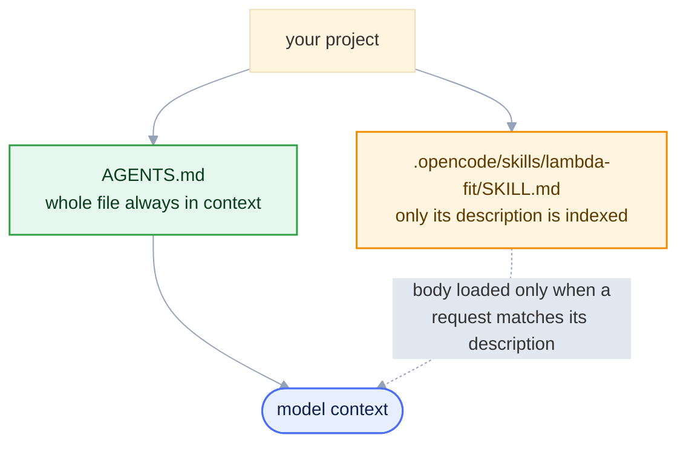

<style>
/* Mermaid: force diagram label text dark so it stays readable on the
   light node fills in BOTH light and dark mode. The Carpentries dark
   theme sets `p`/`li` color and darkens `pre` backgrounds, which would
   otherwise turn mermaid's label text light (invisible on light nodes)
   and the diagram surface dark. We override both, with !important to
   beat the theme rules and mermaid's own inline styles. */
.mermaid { background: transparent !important; }
/* Hide the Workbench "Diagram source code" spoiler under each diagram */
.mermaid-img-wrapper details { display: none !important; }
.mermaid .nodeLabel, .mermaid .edgeLabel, .mermaid .label,
.mermaid .cluster-label, .mermaid text, .mermaid tspan,
.mermaid span, .mermaid p, .mermaid foreignObject div {
  color: #10204a !important;
  fill: #10204a !important;
}
.mermaid .edgeLabel, .mermaid .edgeLabel p, .mermaid .edgeLabel rect {
  background-color: #e2e8f0 !important;
}
/* AI prompts: paste-into-your-assistant blocks. Styled like a normal
   code block (same neutral pre background/border as python etc.), with
   just a small "AI Prompt" tag in the corner. */
pre.ai-prompt, div.sourceCode.ai-prompt {
  border-top: 10px solid #7c3aed;
}
pre.ai-prompt, pre.ai-prompt code {
  white-space: pre-wrap;       /* wrap long prompts onto many lines */
  overflow-wrap: anywhere;
}
pre.ai-prompt::before, div.sourceCode.ai-prompt::before {
  content: "AI Prompt";
  display: block;
  margin-bottom: .5rem;
  font-weight: 600;
  font-size: .78em;
  letter-spacing: .03em;
  text-transform: uppercase;
  color: #7c3aed;
}
</style>

::::::::::::::::::::::::::::::::::::::::::::: questions

- How do you give an assistant durable project context?
- AGENTS.md or SKILL.md: when to use each?
- What's in a usable SKILL.md for the Λ⁰ fit?

:::::::::::::::::::::::::::::::::::::::::::::

::::::::::::::::::::::::::::::::::::::::::::: objectives

- Say what belongs in AGENTS.md and what in a SKILL.md.
- Install the lesson's AGENTS.md and lambda-fit skill.
- Write a small SKILL.md with success criteria.

:::::::::::::::::::::::::::::::::::::::::::::

## Two ways to make instructions persistent

Typed requests (Episode 3) have to repeat the data model, conventions, and procedure every session, and two runs can differ. Two kinds of file solve this.

* **`AGENTS.md`**: **context** read at the start of every session: environment, data model, conventions, and what "done" means.
* **`SKILL.md`**: a **procedure** in a named skill directory, loaded only when a request matches its description. It describes one repeatable workflow.



`AGENTS.md` answers "what is this project and how do we work here?"; a `SKILL.md` answers "how do I carry out *this* task?".

## AGENTS.md: project context

`AGENTS.md` is plain Markdown at your project root. opencode, Codex, Copilot CLI, Cursor, Antigravity, and others
read it automatically. The lesson's file:

```markdown
# AGENTS.md — Lambda analysis in ePIC data

## Data access
- Find datasets with the `rucio` MCP tools; keep `limit` at 50 or less.
- A file's URL is root://epicxrd1.sdcc.bnl.gov:1095//eic/EPIC followed by its
  rucio name (/RECO/...). The `xrootd` tools take the path /eic/EPIC/RECO/...
- Read files only through the `uproot` MCP tools. No downloads, no local
  ROOT/uproot, no software installs.
- Never call get_tree_info on an EDM4eic file (it returns 1.5 MB). Check
  branches with validate_dataset_schema.

## Data model
- Tree `events`, collection ReconstructedChargedParticles:
  .PDG, .momentum.x, .momentum.y, .momentum.z (GeV).
- m(p) = 0.9382720813, m(pi) = 0.13957061, m(Lambda) = 1.115683 GeV.

## Kernels (uproot sandbox)
- np and ak are predefined. No `import`, no tuple unpacking in for-loops,
  np.sum(x) not x.sum().
- Test a kernel on one file with execute_kernel before a dataset call: the
  dataset tools do not show the error.

## When a tool fails
- A timeout means the server is busy. Wait, retry once, then stop and report.

## Definition of done
- Every number comes from a tool call in this session and is reported with the
  dataset DID and the file list.
```

Every line is something the model cannot find out by itself and got wrong in Episode 3: where the
files are served from, which call floods the context, what the sandbox rejects. Two rules:

* **Keep it short.** It is loaded on every turn, so every line costs tokens.
* **Write what went wrong.** When the assistant makes a mistake twice, add one line.

Claude Code reads `CLAUDE.md` instead; make that file one line, `@AGENTS.md`. Do not copy the
rules into a second file: the copies will diverge.

## SKILL.md — a named procedure

A **skill** is a directory containing a `SKILL.md` that describes a repeatable procedure:

```bash
skills/
  lambda-fit/
    SKILL.md              specification: applicability, inputs, steps, success criteria
```


Its YAML frontmatter has a `name` and a
`description`; **only these stay in context**, and the body is read when a request matches the
description. The lesson's skill:

```markdown
---
name: lambda-fit
description: >
  Reconstruct and fit the Lambda0 -> p pi- invariant-mass peak in ePIC EDM4eic
  data. Use when asked to measure the Lambda yield, mass, or width, or to
  reproduce the Lambda peak from a .root file or a file list.
---

# Lambda invariant-mass fit

## Steps
1. Check the input files with validate_dataset_schema.
2. Histogram m(p pi-) and m(pbar pi+) over [1.08, 1.16] GeV in 80 bins, and
   return the counts and their sum. One file: execute_kernel. Many files:
   execute_kernel_dataset with reduce_code, at most 10 files per call.
3. Fit each histogram in one more execute_kernel call: Gaussian + 2nd-order
   polynomial. Scan mu and sigma on a grid and solve the other four parameters
   by weighted linear least squares.
4. Report mu, sigma, the yield S = A sqrt(2 pi) sigma / bin width, and
   chi2/ndf, with uncertainties.

## Success criteria (check before reporting success)
- The entries in the fitted histogram equal the sum returned in step 2. If
  not, counts were lost in copying: redo the fit.
- At least 50 entries. With fewer, report insufficient statistics and stop.
- |mu - 1.115683 GeV| < 0.005 GeV.
- sigma in [0.001, 0.005] GeV (detector resolution).
- chi2/ndf between 0.5 and 1.5.
If any check fails, report the failure and the fit numbers, not a result.

## Provenance
List the dataset DID, the files used, and the tool calls with their arguments.
```

The skill says what to do and how to judge the result, not how to code it; the assistant writes
the kernels.

## Install both files

opencode reads skills from `.opencode/skills/<name>/SKILL.md` in the project directory; Claude Code
uses `.claude/skills/`. In your analysis directory:

```bash
R=https://raw.githubusercontent.com/eic/tutorial-mcp/main/files/skills
curl -fsSLO $R/AGENTS.md
curl -fsSL --create-dirs -o .opencode/skills/lambda-fit/SKILL.md $R/lambda-fit/SKILL.md
```

Restart opencode so it reads them. Loading a skill is the model's decision, based on the skill's
`description`. A small model may answer without loading it, so every prompt in this lesson names
the skill: "Using the lambda-fit skill".

::::::::::::::::::::::::::::::::::::::::::::: challenge

## Exercise: the bare question again (≈ 5 min)

In a new session, with `AGENTS.md` in place, repeat the question from Episode 3 and count the tool
calls:

```{.ai-prompt}
How many events are in the first file of the campaign 26.04.1 BeAGLE eCu ep 10x115 reconstructed-DIS dataset?
```

::::::::::::::: solution

Same answer, 1,223. In the test run: 3 tool calls (`list_dids`, `list_files`,
`validate_dataset_schema`) and 20 s, against 16 calls and 102 s without the file.

:::::::::::::::

:::::::::::::::::::::::::::::::::::::::::::::

## Your project layout

A project that behaves the same under any assistant:

```bash
lambda-analysis/
├── AGENTS.md                        
├── opencode.jsonc                   
└── .opencode/
    └── skills/
        └── lambda-fit/              
            └── SKILL.md            
```

::::::::::::::::::::::::::::::::::::::::::::: challenge

## Exercise: a species-count skill (≈ 10 min)

Write a minimal `SKILL.md` for "count the reconstructed charged particles per PDG code in an
EDM4eic file", place it where your client loads skills, restart the client, and try it on a file
from Episode 3.

::::::::::::::: solution

```markdown
---
name: species-count
description: >
  Count reconstructed charged particles per PDG code in an EDM4eic .root file.
  Use when asked which particle species a reconstruction file contains.
---

# Species count

## Steps
1. validate_dataset_schema on the file: tree 'events', branch
   ReconstructedChargedParticles.PDG. Note the event count.
2. execute_kernel with that branch and this kernel, unchanged:

       def kernel(events):
           pdg = ak.to_numpy(ak.flatten(events["ReconstructedChargedParticles.PDG"]))
           unique = np.unique(pdg, return_counts=True)
           return {"pdg": unique[0].tolist(), "count": unique[1].tolist()}

3. Return a table: PDG code, species name, count, fraction.

## Success criteria
The fractions sum to 1. Code 0 is reported as "no PID", not dropped.
```

Save it as `.opencode/skills/species-count/SKILL.md` and name it in the prompt
("Using the species-count skill, …").

:::::::::::::::

:::::::::::::::::::::::::::::::::::::::::::::

::::::::::::::::::::::::::::::::::::::::::::: challenge

## Optional exercise: richer provenance

Extend the provenance section of `lambda-fit` so a run also records the number of input files and
the total number of candidate pairs.

::::::::::::::: solution

Replace the skill's Provenance section with:

```markdown
## Provenance
List the dataset DID, the files used, the number of input files processed,
the total number of proton-pion candidate pairs entering the histogram, and
the tool calls with their arguments, so the run can be reproduced.
```

The kernel can return the number of pairs before histogramming as one more dictionary entry.

:::::::::::::::

:::::::::::::::::::::::::::::::::::::::::::::

The [next episode](05-end-to-end-agents.md) runs this skill end to end

::::::::::::::::::::::::::::::::::::::::::::: keypoints

- `AGENTS.md` holds project context; a `SKILL.md` holds a procedure the assistant loads when needed.
- Put success criteria in the skill so you can check the result.

:::::::::::::::::::::::::::::::::::::::::::::
