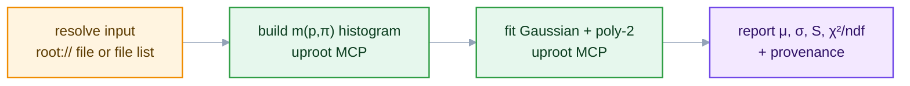
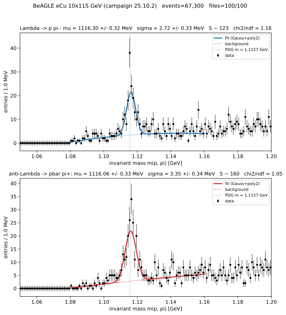

<style>
/* Mermaid: force diagram label text dark so it stays readable on the
   light node fills in BOTH light and dark mode. The Carpentries dark
   theme sets `p`/`li` color and darkens `pre` backgrounds, which would
   otherwise turn mermaid's label text light (invisible on light nodes)
   and the diagram surface dark. We override both, with !important to
   beat the theme rules and mermaid's own inline styles. */
.mermaid { background: transparent !important; }
/* Hide the Workbench "Diagram source code" spoiler under each diagram */
.mermaid-img-wrapper details { display: none !important; }
.mermaid .nodeLabel, .mermaid .edgeLabel, .mermaid .label,
.mermaid .cluster-label, .mermaid text, .mermaid tspan,
.mermaid span, .mermaid p, .mermaid foreignObject div {
  color: #10204a !important;
  fill: #10204a !important;
}
.mermaid .edgeLabel, .mermaid .edgeLabel p, .mermaid .edgeLabel rect {
  background-color: #e2e8f0 !important;
}
/* AI prompts: paste-into-your-assistant blocks. Styled like a normal
   code block (same neutral pre background/border as python etc.), with
   just a small "AI Prompt" tag in the corner. */
pre.ai-prompt, div.sourceCode.ai-prompt {
  border-top: 10px solid #7c3aed;
}
pre.ai-prompt, pre.ai-prompt code {
  white-space: pre-wrap;       /* wrap long prompts onto many lines */
  overflow-wrap: anywhere;
}
pre.ai-prompt::before, div.sourceCode.ai-prompt::before {
  content: "AI Prompt";
  display: block;
  margin-bottom: .5rem;
  font-weight: 600;
  font-size: .78em;
  letter-spacing: .03em;
  text-transform: uppercase;
  color: #7c3aed;
}
</style>

::::::::::::::::::::::::::::::::::::::::::::: questions

- How do assistant + server + skill compose into one analysis?
- How does the kernel scale from one file to many?
- How is the yield extracted and made reproducible?

:::::::::::::::::::::::::::::::::::::::::::::

::::::::::::::::::::::::::::::::::::::::::::: objectives

- Set up any MCP client for the end-to-end run in three steps.
- Scale the analysis from one file to a full dataset.
- Accept or reject an agent-produced yield using the audit checklist.

:::::::::::::::::::::::::::::::::::::::::::::

Continue in the directory from Episodes 3 and 4: servers running (`eic-mcp status`),
`AGENTS.md` and the lambda-fit skill installed, and `/mcp` in opencode listing `uproot`, `xrootd`,
and `rucio`.

## The composed pipeline

The skill (Episode 4) gives the steps, the uproot server (Episode 3) reads the data, and the agent loop (Episode 1) runs and checks it.



## One file, end to end

One request runs the whole chain on the first file of the dataset:

```{.ai-prompt}
Using the lambda-fit skill, measure the Lambda0 peak in this file:
root://epicxrd1.sdcc.bnl.gov:1095//eic/EPIC/RECO/26.04.1/epic_craterlake/DIS/BeAGLE1.03.02-1.0/eCu/ep/10x115/q2_1to1000/BeAGLE1.03.02-1.0_DIS_eCu_ep_10x115_q2_1to1000_ab.0000.eicrecon.edm4eic.root
```

One file gives only about 10 candidates in the fit window, so the correct answer is *insufficient
statistics*: the skill says to stop, and a model that quotes $\mu$ anyway has ignored it.

::::::::::::::::::::::::::::::::::::::::::::: callout

## Smaller models take shortcuts: check the result, not the route

A smaller model may call different tools than the skill says and still get the same histogram. The audit checklist below judges the result, not the route.

:::::::::::::::::::::::::::::::::::::::::::::

## Scaling up

The same kernel can run over many files and return one merged histogram:

```{.ai-prompt}
Using the lambda-fit skill, measure the Lambda0 and anti-Lambda0 peaks in the first 10 files of
the dataset epic:/RECO/26.04.1/epic_craterlake/DIS/BeAGLE1.03.02-1.0/eCu/ep/10x115/q2_1to1000.
```

Ten files take about a minute and a half. For 30 files the skill makes three such calls:

```{.ai-prompt}
Using the lambda-fit skill, repeat the measurement with the first 30 files of the same dataset.
```

Thirty files take about ten minutes. A reference fit:

```output
Lambda      -> p pi-:    mu = 1116.25 +/- 0.37 MeV   sigma = 3.1 +/- 0.5 MeV   S =  97 +/- 19   chi2/ndf = 1.06
anti-Lambda -> pbar pi+: mu = 1115.50 +/- 0.25 MeV   sigma = 2.2 +/- 0.2 MeV   S = 102 +/- 15   chi2/ndf = 0.71
```

The histogram is the same in every run (321 and 294 entries in the window). The assistant writes
its own fit, so $\mu$, $\sigma$, and $S$ vary between runs within these uncertainties.

{alt='Proton–pion invariant-mass spectrum with Gaussian-plus-polynomial fits showing clear Lambda and anti-Lambda peaks near 1.1157 GeV'}

## Extracting the yield

The fit model is a Gaussian signal on a second-order polynomial background over $[1.08, 1.16]$ GeV:

$$
f(m) = A \exp\!\left[ -\tfrac{1}{2} (m - \mu)^2 / \sigma^2 \right] + \left( c_0 + c_1 (m - m_\Lambda) + c_2 (m - m_\Lambda)^2 \right)
$$

The polynomial absorbs the combinatorial background (Episode 2); the integrated signal is $S = A\sqrt{2\pi}\,\sigma / (\text{bin width})$. Report $S$ with its uncertainty alongside $\mu$, $\sigma$, and $\chi^2/\text{ndf}$; a bare bin count mixes signal with background.

## Audit

::::::::::::::::::::::::::::::::::::::::::::: callout

## Audit checklist

* **Signal.** $\mu$ within a few MeV of 1.115683 GeV; $\sigma$ consistent with detector resolution; $\chi^2/\text{ndf}$ of order unity; $S$ reported with an uncertainty.
* **Inputs pinned.** Dataset (campaign and file list), particle masses, mass window, binning, and fit range all fixed and recorded.
* **Provenance.** Tool calls and their arguments logged, so the run can be reconstructed.
* **Cost bounded.** A few files during development before scaling up.
* **Oversight.** A human inspected the fit before the result was reported.

:::::::::::::::::::::::::::::::::::::::::::::

## The whole analysis in one prompt

Everything in Episodes 3 to 5 fits in one request, starting from nothing but the sample name:

```{.ai-prompt}
Using the lambda-fit skill, measure the Lambda0 and anti-Lambda0 peaks in the first 30 files of
the campaign 26.04.1 BeAGLE eCu ep 10x115 reconstructed-DIS dataset.
```

The tools, the skill, and the criteria make this short prompt reproducible: the same request gives
the same histogram on any MCP client.

::::::::::::::::::::::::::::::::::::::::::::: callout

## Try a different beam

The same prompt works with any reconstructed-DIS DID. Nuclear beams (eCu, eAu) give the most Λ per
event; ep samples need a few times more files.

:::::::::::::::::::::::::::::::::::::::::::::

The [final episode](06-eic-mcp-servers.md) lists the other MCP servers the EIC provides.

::::::::::::::::::::::::::::::::::::::::::::: keypoints

- One prompt runs the whole Λ⁰ analysis, from one file to many.
- Check the fit against the audit checklist before you trust it.

:::::::::::::::::::::::::::::::::::::::::::::
